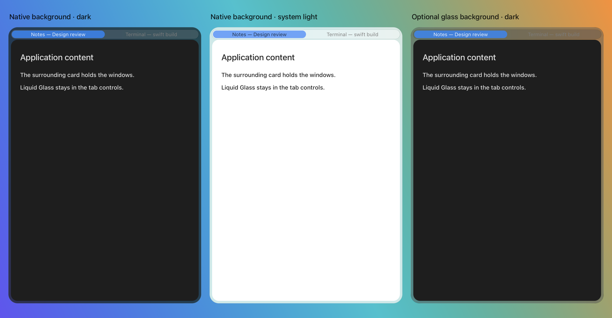
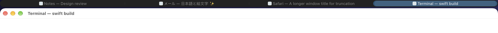
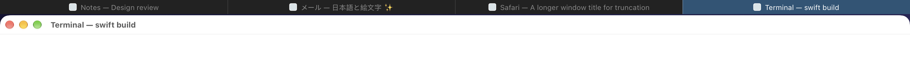
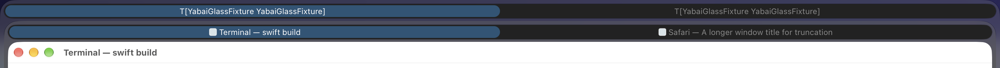
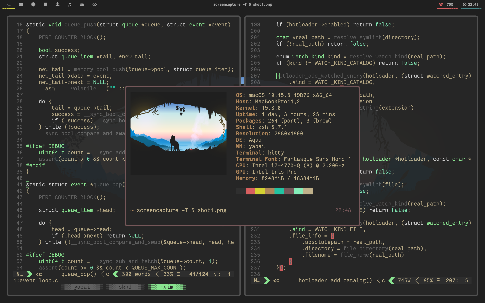

# Personal fork

This is my personal fork of [yabai](https://github.com/asmvik/yabai) by Åsmund Vikane, maintained by me, where I (mostly via coding agents) implement features and bug fixes that I need and then some more.

This fork ports yabai from C to Swift. The daemon and CLI are written in Swift, with C/Objective-C retained for private macOS APIs and the scripting addition's native adapter and loader.

## Fork changes

- [i3/sway container tree](#i3sway-container-tree)
- [Tab bars and adaptive glass](#tab-bars-and-adaptive-glass)
- [Exclusive scratchpads](#exclusive-scratchpads)
- [Native window borders](#native-window-borders)
- [Rule placement](#rule-placement)
- [Window labels](#window-labels)
- [Floating frame memory](#floating-frame-memory)
- [Tree undo](#tree-undo)
- [Automatic space layout](#automatic-space-layout)
- [Space pins](#space-pins)
- [Built-in display last](#built-in-display-last)
- [Automatic padding](#automatic-padding)
- [macOS 27 support](#macos-27-support)
- [Shell completions](#shell-completions)
- [Config check and reload](#config-check-and-reload)
- [IPC batch and subscribe](#ipc-batch-and-subscribe)

Configuration examples can go in your `yabairc`; window commands act on the focused window unless a selector is given. See the [command reference][yabai-docs] for all options.

### i3/sway container tree

Windows live in a tree of horizontal splits (`splith`), vertical splits (`splitv`) and tabbed containers. Containers can be nested: one tab can hold two windows side by side, while another holds a single window.

```text
Horizontal split             Vertical split              Tabbed container
┌──────────┬──────────┐       ┌─────────────────────┐     ┌──────────┬──────────┐
│          │          │       │          A          │     │ A active │    B     │
│    A     │    B     │       ├─────────────────────┤     ├──────────┴──────────┤
│          │          │       │          B          │     │     A visible     │
└──────────┴──────────┘       └─────────────────────┘     └─────────────────────┘
```

`tree` is the default and the only tiling layout; `float` leaves windows unmanaged. New windows open after the focused window in its container, empty containers close automatically, and closing a window restores the previous focus in that container.

#### Configure the tree

```sh
yabai -m config layout tree
yabai -m config tree_default_orientation auto  # side by side on wide displays
yabai -m config tree_workspace_layout default
yabai -m config tree_autotiling on            # split the focused window along its longer side
yabai -m config focus_wrapping on
```

With `tree_autotiling on`, opening B next to A splits A's area; opening C next to B splits B's area along its longer side. Windows opened inside a tabbed container remain tabs. To make new workspace-level groups tabbed instead, use `tree_workspace_layout tabbed`.

#### Arrange and navigate

```sh
yabai -m window --layout tabbed    # turn the current container into tabs
yabai -m window --layout splith    # arrange its children side by side
yabai -m window --layout splitv    # arrange its children top to bottom
yabai -m window --split vertical   # prepare a vertical split for the next window
yabai -m window --focus east
yabai -m window --focus parent     # select the containing group
yabai -m window --focus child      # return to its focused child
yabai -m window --warp west        # move the selected window or group left
yabai -m window --ratio abs:0.6    # give it 60% of its parent's available share
yabai -m query --tree
```

Directional focus walks the tree and enters a neighbouring group at its last focused window. At the edge of a space it can continue onto the next display. `focus_wrapping off` stops at an edge with no display; `force` wraps inside the innermost container instead.

Directional moves follow i3's behavior: they can swap neighbours, enter or leave groups, reorient a space, and cross displays. `--insert`, `--stack`, resizing, zoom, and `space --balance`, `--rotate` and `--mirror` work with the tree. Dragging onto a window edge places a window on that side; dropping in the center swaps them, or creates a tab with `mouse_drop_action stack`.

Binding modes for resizing, layout and moving, built on these commands, are in [examples/skhdrc](examples/skhdrc).

<details>
<summary>Compatibility with upstream bsp/stack configurations</summary>

The upstream `bsp` and `stack` layouts are replaced by `tree`. Use tabbed containers for stacks. `query --windows` reports `split-type` and `stack-index` from the tree; `query --tree` exposes its structure.

The bsp selectors `sibling`, `*_nephew`, `uncle` and `*_cousin`, the `split-child` window property, and the options `split_ratio`, `split_type`, `window_placement`, `window_insertion_point`, `auto_balance` and `window_zoom_persist` are removed.

</details>

### Tab bars and adaptive glass

Every tabbed container gets a clickable bar with window titles and optional application icons, including nested groups. This replaces the stackline Hammerspoon plugin. Glass tabs use native AppKit buttons with hover and press feedback, accessible titles and selection state, and a sliding selection pill.



*Screenshot of the native renderer in a disposable AppKit preview: blur backdrop in dark appearance (left), blur in system light appearance (middle), and glass backdrop in dark appearance (right). The preview uses sample window content; the tab controls and backdrop use the actual renderer.*

Glass tabs with `tab_bar_backdrop off`, captured above a disposable application window:



Flat tabs with `tab_bar_style i3`, captured with the same test windows:



#### Choose the appearance

```sh
yabai -m config tab_bar on
yabai -m config tab_bar_style glass
yabai -m config tab_bar_backdrop blur
yabai -m config tab_bar_appearance system
yabai -m config tab_bar_font system:12
yabai -m config tab_bar_icons on
```

| Option | Behavior |
|---|---|
| `tab_bar_style glass` | Liquid Glass controls in a rounded track; the default. |
| `tab_bar_style i3` | Flat tabs side by side, without a backdrop card. |
| `tab_bar_backdrop blur` | Subdued native background material beneath the controls and windows; the default. |
| `tab_bar_backdrop glass` | Liquid Glass across the whole container card. |
| `tab_bar_backdrop off` | A separate tab track above the windows, without a surrounding card. |
| `tab_bar_appearance dark` | Keep glass controls and cards dark; the default. |
| `tab_bar_appearance system` | Follow macOS light/dark appearance. Does not affect the i3 style. |

Reduce Motion disables transitions and window animations, Reduce Transparency makes backing tints opaque, and Increase Contrast strengthens outlines and default text. Explicitly configured colors take precedence over adaptive defaults.

#### Adjust spacing and colors

```sh
yabai -m config tab_bar_height 24
yabai -m config tab_bar_offset 4          # gap between the bar and the windows
yabai -m config tab_bar_card_padding 6    # inset inside the backdrop card
yabai -m config tab_bar_window_radius 16  # assumed window radius, for concentric card corners

# Optional overrides (colors use 0xAARRGGBB).
yabai -m config tab_bar_focused_color 0xff40566e
yabai -m config tab_bar_focused_text_color 0xffffffff
```

The `tab_bar_focused_*` colors describe the selected tab in the focused group, `tab_bar_inactive_*` describe the selected tab in other groups, and `tab_bar_unfocused_*` describe unselected tabs. `tab_bar_backdrop_color` optionally tints the surrounding card. Leave colors unconfigured to use the adaptive defaults.

#### Put a split inside a tab

```text
┌──────────────────────────┬──────────────────────────┐
│     Work (active)        │          Browser         │
├─────────────────────────┬┴──────────────────────────┤
│                         │                          │
│         Editor          │         Terminal         │
│                         │                          │
└─────────────────────────┴──────────────────────────┘
```

Here, the Work tab contains a horizontal split. Selecting Browser shows its window in place of both Editor and Terminal. Tabs can also contain further tabbed groups, each with its own bar. A glass backdrop encloses the whole group so wallpaper does not show through between its bar and windows.

The screenshot below shows nested tab bars from the live test fixture: the outer row selects a group, and the inner row selects Terminal or Safari within it.



### Exclusive scratchpads

Scratchpads are named floating windows you can summon onto the active space. Assign the focused window a name, then toggle it by that name:

```sh
# Focus your terminal window, then assign it a scratchpad name.
yabai -m window --scratchpad terminal
yabai -m window --toggle terminal
```

These options make scratchpads behave like a shared drop-down panel:

```sh
yabai -m config scratchpad_exclusive on
yabai -m config scratchpad_raise on
yabai -m config scratchpad_below on
yabai -m config scratchpad_grid 10:10:1:1:8:8
```

| Situation | Result with these options |
|---|---|
| Terminal is shown; toggle a second scratchpad named Notes. | Notes appears and Terminal hides, even if Terminal is on another display. |
| Notes is focused; toggle Notes again. | Notes hides. Terminal stays hidden. |
| Notes is shown but covered by a tiled editor; toggle Notes. | Notes is focused and raised instead of hidden. |
| Notes is shown; focus the tiled editor. | The editor can cover Notes because `scratchpad_below` puts it on the tiled stacking sub-layer. |
| Notes is hidden; toggle it. | It opens centered at 80% width and height using the configured grid. |
| Notes is shown on another space; toggle it here. | It moves to the active space and keeps its current frame, without switching back to its old space. |

`scratchpad_grid` applies when a hidden scratchpad is shown. It does not reset the frame of one that is already shown. Set it to `off` to preserve the frame on every toggle. An explicit `window --sub-layer` setting overrides automatic scratchpad layering. Scratchpad toggling, exclusivity and below-layer behavior require the scripting addition and partially disabled SIP.

### Native window borders

Built-in borders show the focused window without a separate JankyBorders process. Each border uses four thin SkyLight windows, follows window-server move/resize notifications, and changes color when yabai sees a focus change.

```sh
yabai -m config window_border on
yabai -m config window_border_width 3
yabai -m config active_window_border_color 0xff8aadf4
yabai -m config normal_window_border_color 0xff494d64
yabai -m config window_border_hide_single on
```

The active tab's border encloses the whole tabbed container, including its bar and backdrop card. Hidden tabs have no border. With `window_border_hide_single on`, a single visible tiled window has no border; a split inside the active tab still counts as multiple visible windows, so focus remains visible. Hidden tabs and scratchpads do not count toward this total; floating windows retain their borders.

<details>
<summary>Measurements against JankyBorders</summary>

Measured with border width 3 and JankyBorders `hidpi=on`, on macOS 27 with two 4K displays and the laptop display, 9 windows. Latency is the time from `yabai -m window --focus` until the border color changes on screen, over 3 alternating runs of 40 focus switches each; CPU is a workload of 20 resize/focus/move rounds. These are measurements from that setup, not guarantees for other configurations.

| | Native `window_border` | JankyBorders |
|---|---|---|
| Memory (process footprint) | yabai stays at 28 MB | `borders` 187 MB (89 MB on the laptop display alone) |
| Wired memory added | +35–85 MB (within noise) | +150–275 MB |
| Focus latency, same app (median / p90) | 52–70 ms / 82–111 ms | 133–165 ms / 146–191 ms |
| Focus latency, across apps (median / p90) | 78–89 ms / 104–110 ms | 167–207 ms / 207–266 ms |
| Worst focus switch (about 1 in 40) | 0.35–0.75 s | 0.3–0.45 s |
| CPU of yabai + `borders` | 0.86–0.94 s | 1.47–1.66 s |
| CPU of WindowServer | 5.8–6.4 s | 4.9–5.5 s |

</details>

### Rule placement

A rule can place the windows of an application in the tree when they open. `insert` takes the same side as `window --insert`, or `stack` to open the window as a tab of the focused window's container:

```sh
# Slack windows open as tabs next to the focused window
yabai -m rule --add app='^Slack$' insert=stack
# Terminal windows open to the east of the focused window
yabai -m rule --add app='^Terminal$' insert=east
```

The placement applies to new windows, at the moment they are first tiled. Windows that already exist when yabai starts, windows that `rule --apply` matches and windows tiled later (for example after floating) are not placed by it. Rules with `manage=off` ignore it.

### Window labels

A window can be labelled, and the label then selects that window wherever a window selector is taken, as i3 marks do:

```sh
yabai -m window --label term   # label the focused window
yabai -m window --focus term   # focus it
yabai -m window --swap term    # swap the focused window with it
yabai -m window --label        # remove the label of the focused window
```

A label names one window: labelling another window moves it there. `yabai -m query --windows` reports the label as `label`. Scratchpad names (`--scratchpad`) are a separate namespace, so a window label and a scratchpad may share a name.

### Floating frame memory

A window that floats remembers the frame it had while floating. When it floats again with `yabai -m window --toggle float`, it returns to that frame if at least half of the frame is on a display. Otherwise it is centered at its current size on its display. A window that has never floated keeps its tiled frame when it floats, as before.

### Tree undo

`yabai -m space --undo` restores the tree of the selected space as it was before its last change by a tree command: `--balance`, `--mirror`, `--rotate`, or a window's `--warp`, `--swap`, `--stack`, `--layout`, `--split`, `--ratio`, `--resize` and `--toggle split`. Each space keeps its last 10 trees, for as long as its windows stay the same. Undo fails, and drops the kept trees of the space, when a window was added to or removed from the space since. Moving windows to another space or display and `--insert` are not undone.

### Automatic space layout

`space_layout` keeps a fixed number of spaces on each display. Give one colon-separated layout for each number of connected displays you use:

```sh
yabai -m config space_layout 15 10:5 10:5:1b
```

| Connected displays | Layout selected | Space counts |
|---|---|---|
| 1 | `15` | 15 spaces on the only display. |
| 2 | `10:5` | 10 on the first display, 5 on the second, in arrangement order. |
| 3, including the built-in display | `10:5:1b` | 10 and 5 on the external displays, 1 on the built-in display. |

The `b` suffix binds that entry to the built-in display; other entries follow display arrangement order. After displays or spaces change, yabai moves spaces between displays and creates or removes spaces to reach the selected layout. Only empty spaces are destroyed, so a space containing windows can keep a display above its target count. This feature requires the scripting addition and partially disabled SIP.

```sh
yabai -m config space_layout off  # stop enforcing counts
```

### Space pins

`space --pin` keeps a labelled space on a display. The space returns to that display whenever the display is connected:

```sh
yabai -m space web --label web
yabai -m space web --pin 2   # display 2 in arrangement order
yabai -m space web --pin     # remove the pin
```

A pin is kept by the display's uuid, so it survives display index changes, and it is set in memory: put the commands in your yabairc. Pins are applied when they are set, after a display is added, removed or moved, and at startup. A pinned space is not moved back when you move it by hand, and `space_layout` never moves or destroys it. Moving a space needs the scripting addition.

### Built-in display last

Keep external displays first in display and space indices, regardless of where the laptop sits in the physical arrangement:

```sh
yabai -m config builtin_display_last on
```

For example, with 10 spaces on the first external display, 5 on the second, and 1 on the laptop, the external displays are indices 1 and 2 with spaces 1–15. The laptop is display 3 with space 16. This works with `space_layout 10:5:1b` to keep external workspace numbers stable while the laptop display is also connected.

### Automatic padding

`auto_padding` removes outer padding when a tree space has at most one tiled window or tabbed container, then restores it when more containers appear. The configured values stay unchanged.

```sh
yabai -m config top_padding 12
yabai -m config bottom_padding 12
yabai -m config left_padding 12
yabai -m config right_padding 12
yabai -m config window_gap 8
yabai -m config auto_padding on

# Or apply only to space 2:
yabai -m config --space 2 auto_padding on
```

| Space contents | Outer padding |
|---|---|
| One tiled window | Removed; the window fills the usable display area. |
| Two windows side by side at the workspace level | The configured 12 points return. |
| One tabbed container with several tabs | Removed; the group counts once, including a split inside a tab. |
| One tiled window plus a floating scratchpad | Removed; floating windows do not count. |

Window gaps, the menu bar, Dock and `external_bar` reservations are still respected. `window --grid` always uses the configured padding and gap, so a scratchpad's grid frame does not change when another tiled window opens. `auto_padding` has no effect on `float` spaces.

### macOS 27 support

This fork targets macOS 27 on Apple Silicon. Window notifications and window sub-level queries use the Tahoe-compatible paths rather than falling back to pre-Sequoia behavior. The daemon and client build for arm64, and the injected scripting addition builds for arm64e. There is no configuration switch for older macOS releases or Intel Macs.

### Shell completions

The options of `yabai` are parsed by [swift-argument-parser](https://github.com/apple/swift-argument-parser), which generates completion scripts for zsh, bash and fish:

```sh
yabai --generate-completion-script zsh > "${fpath[1]}/_yabai"
yabai --generate-completion-script fish > ~/.config/fish/completions/yabai.fish
```

They complete the options of the process (`--start-service`, `--config <file>`, …), not the messages after `-m`.

### Config check and reload

`yabai -m config --check [<file>]` parses the `yabai -m` messages of a yabairc without running them. Each failure is printed with its file and line, and a summary follows:

```sh
yabai -m config --check
```

```text
/Users/you/.config/yabai/yabairc:12: unknown value 'x' given to command 'window_gap' for domain 'config'; expected a non-negative integer
note: /Users/you/.config/yabai/yabairc:20: not checked: dynamic shell
checked 14 commands, 1 failures, 1 skipped
```

Without a file, the check reads the file the daemon loads. Lines that the shell computes when it runs them are not checked, and neither are the messages of *space*, *display*, *window* and *query*, which act on the session. Nothing is applied, and the exit status is 1 when there is a failure.

`yabai -m config --reload [<file>]` runs the yabairc again without restarting the daemon. It checks the file first, as above, and changes nothing when the check fails. Otherwise it resets the config to its startup defaults, removes every rule and signal, and runs the file as at startup. Windows and spaces stay as they are, so the yabairc must be idempotent. An skhd binding can run `yabai -m config --reload`.

### IPC batch and subscribe

`yabai -m batch` runs many commands in one message, one round trip instead of one process per command. Its commands come from stdin, one per line, with the words that follow `yabai -m`:

```sh
yabai -m batch <<'EOF'
config window_gap 6
config top_padding 12
window --focus east
EOF
```

The commands run in order, each as it would on its own. A failing command is reported with its number in the batch, and the others still run; the response fails if any of them failed. Lines are not run by a shell, so variables and command substitutions are errors. The command reference describes the rules under *Batch*.

`yabai -m subscribe` streams events instead: it takes the event names of `signal --add` (or none, for all of them) and prints one JSON line per event until the daemon ends it. For example, a SketchyBar item can redraw on each space change with [`examples/sketchybar-subscribe.sh`](examples/sketchybar-subscribe.sh). The command reference describes the line format under *Subscribe*.

---

<!-- Please be careful editing the below HTML, as GitHub is quite finicky with anything that looks like an HTML tag in GitHub Flavored Markdown. -->
<p align="center">
  
</p>
<p align="center">
  <b>Tiling window management for the Mac.</b>
</p>
<p align="center">
  <a href="https://github.com/braun-steven/yabai/blob/main/LICENSE.txt">
    
  </a>
  <a href="https://github.com/braun-steven/yabai/blob/main/doc/yabai.asciidoc">
    
  </a>
  <a href="https://github.com/asmvik/yabai/wiki">
    
  </a>
  <a href="https://github.com/braun-steven/yabai/blob/main/CHANGELOG.md">
    
  </a>
  <a href="https://github.com/braun-steven/yabai/releases">
    
  </a>
</p>

## About



yabai is a window management utility that is designed to work as an extension to the built-in window manager of macOS.
yabai allows you to control your windows, spaces and displays freely using an intuitive command line interface and optionally set user-defined keyboard shortcuts using [&nearr;&nbsp;skhd][gh-skhd] and other third-party software.

The primary function of this fork is tiling window management using an i3-style container tree, with horizontal, vertical and tabbed containers.
Additional features of yabai include focus-follows-mouse, disabling animations for switching spaces, creating spaces past the limit of 16 spaces, and much more.

## Installation and Configuration

- The [&nearr;&nbsp;upstream&nbsp;wiki][yabai-wiki] has installation and uninstallation instructions for upstream yabai. For this fork, use the build instructions below; upstream packages do not include the fork changes.
- Sample configuration files can be found in the [&nearr;&nbsp;examples][yabai-examples] directory. Refer to the [&nearr;&nbsp;documentation][yabai-docs] or the wiki for further information.
- Keyboard shortcuts can be defined with [&nearr;&nbsp;skhd][gh-skhd] or any other suitable software you may prefer.

## Requirements and Caveats

This fork targets macOS 27 on Apple Silicon. The daemon, client and scripting-addition core are Swift; private API wrappers and the native Dock adapter/loader remain C/Objective-C.

Please read the below requirements carefully.
Make sure you fulfil all of them before filing an issue.

|Requirement|Note|
|-:|:-|
|Operating&nbsp;System&nbsp;Apple Silicon|macOS 27; arm64 daemon/client and arm64e scripting addition. Intel builds are not supported by this fork.|
|Accessibility&nbsp;API|yabai must be given permission to utilize the Accessibility API and will request access upon launch. The application must be restarted after access has been granted.|
|Screen Recording|yabai must be given Screen Recording permission if and only if you want to enable window animations, and will request access when necessary. The application must be restarted after access has been granted.|
|System&nbsp;Settings|In the Desktop & Dock tab, inside the Mission Control pane, the setting "Displays have separate Spaces" must be enabled.|

Please also take note of the following caveats.

|Caveat|Note|
|-:|:-|
|System&nbsp;Integrity&nbsp;Protection (Optional)|System Integrity Protection can be (partially) disabled for yabai to inject a scripting addition into Dock.app for controlling windows with functions that require elevated privileges. This enables control of the window server, which is the sole owner of all window connections, and enables additional features of yabai.|
|Code&nbsp;Signing|When building from source (or installing from HEAD), it is necessary to codesign the binary so it retains its accessibility and automation privileges when updated or rebuilt.|
|Finder&nbsp;Desktop|Some people disable the Finder Desktop window using an undocumented defaults write command. This breaks focusing of empty spaces and should be avoided when using yabai. To re-activate the Finder Desktop, run: "defaults write com.apple.finder CreateDesktop -bool true".|
|NSDocument-based&nbsp;Applications|Windows that utilize native macOS tabs such as Terminal and Finder, [do not behave correctly when creating tabs](https://github.com/asmvik/yabai/issues/68). Avoid creating tabs in these applications, consider alternatives that do not use NSDocument's tab system, or make these windows float using rules.|
|System&nbsp;Settings|In the Desktop & Dock tab, inside the Mission Control pane, the setting "Automatically rearrange Spaces based on most recent use" should be disabled for commands that rely on the ordering of spaces to work reliably.|
|System&nbsp;Settings|In the Desktop & Dock tab, inside the Desktop & Stage Manager pane, the setting "Show Items On Desktop" should be enabled for display and space focus commands to work reliably in multi-display configurations.|
|System&nbsp;Settings|In the Desktop & Dock tab, inside the Desktop & Stage Manager pane, the setting "Click wallpaper to reveal Desktop" should be set to "Only in Stage Manager" for display and space focus commands to work reliably.|

## Building this fork

Requirements: Xcode with the macOS 27 SDK and Swift 6.4, plus just (`brew install just`).

SwiftPM builds the complete executable, including the embedded arm64e scripting addition through the `OSAXEmbed` build plugin. The `justfile` provides convenience commands that copy successful builds to `bin/yabai`.

```sh
swift build          # complete debug build, including the scripting addition
swift test           # Swift unit tests and byte-for-byte golden IPC replay
just                 # debug binary at bin/yabai
just install         # optimized release binary at the same path
just test            # Swift unit tests and byte-for-byte golden IPC replay
just asan            # AddressSanitizer build
just tsan            # ThreadSanitizer build
just check-build     # isolated build-system upgrade checks and Swift tests
```

`just install` builds locally; it does not copy the binary into your PATH. A failed build preserves the last successful `bin/yabai`. Sign a rebuilt binary with your existing signing identity before replacing an installed copy, so macOS preserves its Accessibility permission. `just clean` removes both packages' build products. The package opts into SwiftPM's experimental C-source generation support; see [build details](doc/building.md) and [the live-testing notes](doc/live-testing.md) before deploying a test build; restarting yabai resets container layouts.

The scripting addition uses the Swift core (2.1.37), with private Dock operations in a native
adapter. `just osax-test` tests it outside Dock; `just osax-payload` builds the standalone payload
without injecting it. The unused Objective-C prototype has been removed. See the
[comparison results and reload procedure](doc/osax-prototypes.md).

## License and Attribution

yabai is licensed under the [&nearr;&nbsp;MIT&nbsp;License][yabai-license], a short and simple permissive license with conditions only requiring preservation of copyright and license notices.
Licensed works, modifications, and larger works may be distributed under different terms and without source code.

Thanks to [@fools-mate][gh-fools-mate] for creating a logo and banner for this project and making them available for free.

Thanks to [@dominiklohmann][gh-dominiklohmann] for contributing great documentation, support, and more, for free.

## Disclaimer

Use at your own discretion.
I take no responsibility if anything should happen to your machine while trying to install, test or otherwise use this software in any form.
You acknowledge that you understand the potential risk that may come from disabling [&nearr;&nbsp;System&nbsp;Integrity&nbsp;Protection][external-about-sip] on your system, and I make no recommendation as to whether you should or should not disable System Integrity Protection.

<!-- Project internal links -->
[yabai-license]: LICENSE.txt
[yabai-examples]: https://github.com/braun-steven/yabai/tree/main/examples
[yabai-wiki]: https://github.com/asmvik/yabai/wiki
[yabai-docs]: https://github.com/braun-steven/yabai/blob/main/doc/yabai.asciidoc

<!-- Links to other GitHub projects/users -->
[gh-skhd]: https://github.com/asmvik/skhd
[gh-fools-mate]: https://github.com/fools-mate
[gh-dominiklohmann]: https://github.com/dominiklohmann

<!-- External links -->
[external-about-sip]: https://support.apple.com/en-us/HT204899
